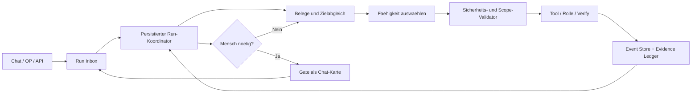

# ADR-0032: Adaptiver, zielorientierter Run-Kern

- **Datum:** 2026-11-12
- **Status:** accepted
- **Ersetzt:** ADR-0010s separates Memory-Speicherdesign sowie die starre
  Phasenfolge als Laufzeitsteuerung; nicht die fachlichen Aufgaben, Rollen
  oder erforderlichen Freigaben
- **Ergaenzt:** ADR-0006, ADR-0007, ADR-0019, ADR-0020, ADR-0022,
  ADR-0024, ADR-0029, ADR-0030 und ADR-0031
- **Grundlage:** Nutzerfreigabe zum vollstaendigen Umbau vom 2026-11-12
- **Ist-Aufnahme:** [Ist-Zustand des Loops](../IST-ZUSTAND-LOOP-2026-11-12.md)

## Kontext und Entscheidung

Der Werkstatt-Loop soll komplexe, repo-orientierte Auftraege verlaesslich
bis zu einem belegten Ergebnis verfolgen. Er muss waehrend der Arbeit
ansprechbar bleiben, neue Fragen sofort von Schreibarbeit trennen, sichere
Eingriffe aufnehmen und Fehler am Ort ihres Auftretens diagnostizieren.
Der aktuelle Run-Einstieg ruft dagegen eine feste Folge von Setup, Plan,
Task-Loop und Finalizer auf. Recovery ist innerhalb einzelner Pfade moeglich,
aber kein einheitliches Verhalten jedes Runs.

**Entscheidung:** Die Runtime wird zu einem dauerhaften, zielorientierten
Koordinator mit persistiertem Run-Zustand, Ereignis-Inbox, Checkpoints und
belegbasierter Fehlerbehandlung umgebaut. Eine feste Phasenfolge ist keine
Voraussetzung mehr. Der Koordinator waehlt die naechste erlaubte Aktion aus
dem tatsaechlichen Zielzustand, den Belegen und der Nutzerfreigabe. Die
Bezeichnungen Setup, Plan, Build, Verify oder Review duerfen als fachliche
Labels in UI und Audit weiterleben; sie steuern den Lauf nicht mehr als
zwingende globale Reihenfolge.

Die Umsetzung wird in lieferbaren Meilensteinen ausgerollt. Diese
Meilensteine sind Migrationsarbeit und keine Laufzeitphasen des neuen
Koordinators.

## 1. Einheitlicher Run-Vertrag

Ein Run entsteht aus einem Chat-Auftrag, einer bewusst ausgewaehlten OP
oder einer freigegebenen OP-Gruppe. Alle Einstiege erzeugen denselben
persistierten Datensatz:

- stabile `run_id`, Projekt, ausloesende Session und Elternauftrag;
- Nutzerziel, Akzeptanzkriterien, erlaubte Aenderungsbereiche und Stop-Grenzen;
- gepinnter Basis-Commit, Checkout/Worktree und Laufbesitzer/Lease;
- aktueller Zustand, naechste Aktion, Inbox-Offset und Checkpoint-Version;
- Task-Abhaengigkeiten als veraenderbarer Arbeitsgraph, nicht als starre
  Skriptliste;
- Evidence Ledger mit Fundstelle, Befehl, Exit-Code, Zeit, Commit-SHA und
  Artefakt-Hash fuer jede relevante Behauptung;
- getrennte Call-/Zeit-/Token-/Kostenbudgets sowie Verlauf bisheriger
  Reparaturversuche und deren Ergebnisse.

Der persistierte Datensatz ist die Run-SSOT. Web-UI, Chat und CLI lesen
denselben Zustand. Dokumentation beschreibt Absicht und Verlauf, aber nicht
den Live-Prozesszustand.



## 2. Chat als Control Plane; Koordinator als Ausfuehrung

Der Chat bleibt die natuerliche Bedienoberflaeche; er und der Run-Worker
sind getrennte Ausfuehrungsfaehigkeiten mit einem gemeinsamen Run-Vertrag.
Ein langsamer Builder oder Verify-Befehl blockiert keine Chatfrage.

Jede eingehende Nachricht wird einer klaren Klasse zugeordnet:

| Klasse | Verhalten |
|---|---|
| Frage | Read-only Antwort auf einem unveraenderlichen Live-/Repo-Snapshot; laeuft unabhaengig vom Writer. |
| Diagnose | Read-only Job mit Run-ID, Logs und Belegen; Ergebnis erscheint in derselben Session und Timeline. |
| Steuerung | Start, Pause, Fortsetzen oder Stop durch typisierte, idempotente Aktion; sofortiger Status im Chat. |
| Schreibauftrag | Inbox-Ereignis fuer aktiven oder neuen Run; am Checkpoint Scope pruefen und ggf. Plan aktualisieren. |
| Gate-Antwort | Gilt nur fuer eine eindeutig referenzierte offene Freigabe; sonst gezielt nachfragen. |

Eine neue Schreibanweisung wird nicht ignoriert und unterbricht auch nicht
mitten in einem Tool-Aufruf den Working Tree. Der Koordinator nimmt sie
sofort an, ordnet sie als Folgeauftrag, Scope-Erweiterung oder unabhaengige
Arbeit ein und meldet den aktuellen Stand. Am naechsten sicheren Checkpoint
entscheidet er deterministisch:

1. Innerhalb des freigegebenen Ziels: in den Arbeitsgraph aufnehmen.
2. Aenderung an Scope, Akzeptanz oder Risiko: pausieren, Chat-Karte mit
   konkreter Planrevision und Empfehlung vorlegen; neue Freigabe einholen.
3. Unabhaengiger Schreibauftrag: eigenen Run und Worktree anlegen; Integration
   pro Projekt serialisieren.
4. Frage oder Diagnose: parallel auf einem Snapshot beantworten.

Eine interne Planrevision ist keine Nutzeraufgabe. Der Chat erklaert nur,
was sich am Ziel, Risiko oder Diff aendert und warum eine Freigabe erforderlich
ist. Die bestehende Plan- und Ergebnisfreigabe wird nie durch Modellurteil,
Auto-Approve oder normale Prosa ersetzt.

## 3. Arbeitsgraph statt Phasen und Runden

Der Koordinator fuehrt einen kleinen Abhaengigkeitsgraphen aus konkreten
Aufgaben und Akzeptanzkriterien. Aufgaben werden bei Bedarf erzeugt, in
kleinere sichere Schritte geteilt, als erledigt belegt oder aufgrund neuer
Evidenz angepasst. Ein abgeschlossener Verify-Schritt ist nur ein Beleg fuer
ein Kriterium; er bedeutet nicht automatisch, dass das Gesamtziel fertig ist.

An jedem Checkpoint werden drei Fragen beantwortet:

1. Welche Akzeptanzkriterien sind durch aktuelle Belege erfuellt?
2. Welcher kleinste sichere Schritt bewegt ein offenes Kriterium voran?
3. Ist dieser Schritt innerhalb der Freigabe und des verbleibenden Budgets?

Der Lauf endet bei belegter Zielerreichung und erfolgreicher Endpruefung,
explizitem Nutzerstopp, notwendiger menschlicher Entscheidung oder einer
konkreten Sicherheits-/Budgetgrenze. Es gibt keine pauschale
`maxrounds=5`-Abbruchregel fuer den Gesamtauftrag. Begrenzungen bleiben
pro Modellaufruf und Prozess bestehen; der Run budgetiert Zeit, Kosten,
Versuche und Ressourcen. Bei Erschoepfung wird ein wiederaufnehmbarer
Checkpoint mit offenem Befund gespeichert, nicht eine falsche finale Antwort.

Stagnation wird anhand von Beobachtungen erkannt: gleiche Aktion plus
gleiches Ergebnis, unveraenderte Fehler-Signatur, kein neues Kriterium mit
Beleg oder wiederholte Ruecknahme desselben Patches. Stagnation erzwingt
zuerst eine Kurskorrektur mit anderem gezieltem Beleg oder Reparaturansatz.
Bleibt der Fortschritt aus, pausiert der Run mit Diagnose und konkreter
Rueckfrage. Sie verhindert unendliche Wiederholung, ohne eine starre Zahl
von LLM-Runden zum Erfolgs- oder Abbruchkriterium zu machen.

### Fortlaufendes Arbeiten und erneuter Zielabgleich

Der Run behaelt ein persistiertes Hauptziel, auch wenn der Chat waehrend
der Ausfuehrung eine Zwischenfrage beantwortet oder ein neues Anliegen
aufnimmt. Eine neue Nachricht ersetzt den laufenden Auftrag nicht implizit.
Der Koordinator ordnet sie als Frage/Diagnose, Steuerung, Gate-Antwort,
Folgeauftrag innerhalb des freigegebenen Scopes oder separaten bzw.
scopeveraendernden Schreibauftrag ein. Unklare Zuordnung wird sichtbar
gemacht und am Chat geklaert. Jede angenommene Nachricht bleibt mit Projekt,
Session, Run, Elternauftrag und Idempotenzschluessel nachvollziehbar; ein
Reconnect setzt denselben Arbeitsstand fort.

An jedem sicheren Checkpoint baut der Koordinator den naechsten Schritt aus
dem aktuellen Stand neu auf: Nutzerziel und Freigabe, offene
Akzeptanzkriterien, aktuelle Code-/Dokumentationsbasis, neue Inbox-Ereignisse,
Verify-/Review-Belege und bisherige Reparaturversuche werden abgeglichen.
Ein gruener Einzelcheck beantwortet nur die Frage, die dieser Check auf dem
geprueften SHA abdeckt. Er beendet den Run nicht, solange Zielkriterien,
Dokumentation oder erforderliche Gesamtpruefungen offen oder widerspruechlich
sind. Nach einem Fehler wird zuerst die Ursache mit einem konkreten neuen
Beleg eingegrenzt; dieselbe erfolglose Aktion wird nicht als Fortschritt
wiederholt. Nach Patch oder Replan werden Freigabe, Diff, betroffene Checks
und Gesamtziel erneut geprueft. Modellurteile allein sind weder Fortschritts-
noch Erfolgsbelege.

Dokumentation ist Teil des Arbeitsprodukts und des Verify-Vertrags:

- Jede relevante Code-/UI-Aenderung erhaelt einen append-only
  PROGRESS-Eintrag mit Zweck, betroffenen Bereichen und tatsaechlichen
  Test-/Verify-Ergebnissen. Ausgefuehrte und nicht ausgefuehrte Checks werden
  getrennt benannt; CI-Belege sind an Commit-SHA und Lauf gebunden.
- STATUS.md wird aktualisiert, wenn OPs beginnen, blockiert, umgeschnitten
  oder durch belegte Akzeptanzkriterien abgeschlossen werden. Eine OP wird
  nicht allein deshalb geschlossen, weil ein Teilfix oder Commit existiert.
- ROADMAP.md wird nur bei einer Aenderung von Fokus, Reihenfolge oder
  Meilenstein angepasst. ARCHITECTURE.md und ADRs werden angepasst, wenn sich
  implementiertes Verhalten oder eine angenommene Entscheidung aendert.
- Vor einer Abschlussantwort vergleicht der Koordinator Ziel und Freigabe,
  Status/Progress/Roadmap/Architektur, tatsaechlichen Diff und Tests mit dem
  exakten geprueften Stand. Nicht belegte Aussagen bleiben als offen,
  unbekannt oder nicht ausgefuehrt markiert.

Die Timeline darf den aktuellen Zweck, die gepruefte Quelle, das Ergebnis
und den naechsten Schritt in menschlich lesbarer Form zeigen. Sie zeigt keine
verdeckten Modellgedankengaenge. Vollstaendige Kommandos, Ausgaben und
Artefakte bleiben fuer Debug/Replay verlinkt und werden nur begrenzt und
markiert in den Chatkontext uebernommen.

## 4. Fehlerbehandlung: Fehler werden Eingaben fuer denselben Run

Jeder fehlgeschlagene Tool-, Builder-, Reviewer- oder Verify-Schritt wird zu
einem strukturierten Failure Record:

- Run-/Task-ID, Kategorie, betroffene Akzeptanzkriterien und Scope;
- Kommando, Exit-Code, begrenzter Log-Auszug plus Verweis auf Vollartefakt;
- Basis- und Arbeits-SHA, betroffene Pfade und Diff-Hash;
- vorherige Versuche, deren Patches und beobachtete Resultate.

Der Koordinator verarbeitet den Befund in derselben Run-ID:

```text
Fehler erfassen -> Fehlerklasse bestimmen -> Ursache mit Belegen pruefen
-> kleinste zulässige Reparatur planen -> patchen
-> fokussiert verifizieren -> betroffene Regressionen pruefen
-> Gesamtziel und Freigabe erneut abgleichen -> fortsetzen oder pausieren
```

Ein Modell darf Hypothesen liefern, aber keinen Erfolg attestieren. Nur
ausgefuehrte, auf den aktuellen Arbeits-SHA bezogene Pruefungen werden als
Verify-Beleg gewertet. Ein erfolgreicher Teiltest ist kein erfolgreicher
Run. Unbekannte Fehlerklasse, fehlende Belege, Sicherheitsfund, Scope-
Ueberschreitung oder wiederholter Stillstand gehen mit Diagnose und
Empfehlung als Chat-Karte an den Menschen. Das Ergebnis-Gate bleibt bestehen.

### Doku und Verify-Reihenfolge

Der aktuelle Doku-Drift-Zyklus muss als erste konkrete Zuverlaessigkeitsarbeit
aufgeloest werden. `doku_drift` bleibt fail-closed, aber der Lauf muss seinen
PROGRESS-Abschluss und noetige Doku-Aenderungen vor der endgueltigen
Doku-Pruefung vorbereiten. Danach laufen Doku- und Codepruefungen auf dem
tatsaechlichen Abschlussstand. Ein rotes Ergebnis geht in den Failure Record
und zurueck an den Koordinator statt unmittelbar zum Run-Abbruch. Commit
erfolgt erst nach erfolgreichem Verify und Gate. Weder `hart:false` noch ein
anderer Konfigurationsschalter darf die Bedeutung der harten Stufe still
aufweichen.

## 5. Rollen und Modellaufrufe nach Bedarf

Rollen beschreiben Faehigkeiten und Qualitaetskontrollen, keine obligatorische
LLM-Kette. Der deterministische Koordinator entscheidet nach Auftragsrisiko,
Unsicherheit, Beleglage und erwartbarem Nutzen:

| Faehigkeit | Wann einsetzen | Regel |
|---|---|---|
| Repo-Explorer | Breites, neues oder mehrdeutiges Vorhaben | Read-only, gezielte Datei-/Symbolbelege. Enges explizites Ziel braucht keinen Scout-LLM-Aufruf. |
| Architect/Reasoner | Architektur-, Multi-Datei- oder mehrdeutiger Auftrag | Strukturiertes Planobjekt mit Kriterien, Abhaengigkeiten, Risiken und Verify; nur ein Syntheseschritt als Normalpfad. |
| Plan-Compiler | Jeder generierte/geaenderte Plan | Deterministisch Schema, Vollstaendigkeit, Abhaengigkeiten und Grenzen pruefen; ersetzt den separaten LLM-Task-Split, sobald Evaluation Gleichwertigkeit belegt. |
| Spec-Builder | Bei hoher Komplexitaet, neuen Schnittstellen, mehrdeutigen Anforderungen oder hohem Regressionsrisiko | Erstellt unabhaengige Akzeptanztests/Vertrag; diese werden vor dem Codebau geprueft und eingefroren. Bei klaren, kleinen Aufgaben wird diese Faehigkeit ausgelassen. |
| Builder | Schreibende Umsetzung | Ein Writer pro Worktree; begrenzte Werkzeuge und voller Run-Kontext fuer nachvollziehbare Events. |
| Verify | Jede relevante Aenderung | Deterministische Projektpruefungen auf dem aktuellen integrierten SHA. |
| Reviewer | Risiko, neue Schnittstelle, grosse/mehrdeutige Aenderung oder negatives Verify | Unabhaengig vom Builder; Befunde muessen auf Diff/Anforderung verweisen. |
| Reflection/Debugger | Konkreter Fehler, Widerspruch oder Stagnation | Keine Reflexion ohne neuen Befund; Reparaturpfad statt eigenstaendiger, unverbundener Loop. |

Rollen werden nicht allein wegen theoretischer Tokenersparnis entfernt. Der
Planner-Split wird erst ersetzt, wenn ein Eval-Satz nachweist, dass ein
strukturierter Architect-Plan plus Compiler keine Abdeckung, Task-Reihenfolge
oder Sicherheit verliert. Parallel ist Read/Diagnose moeglich; schreibende
Arbeit nutzt getrennte Worktrees auf gepinnter Basis und wird bei Integration
serialisiert. Nach Integration laufen relevante Gates erneut auf dem
kombinierten SHA.

### Bedarfsweiser Spec-First-Pfad

Wenn der Koordinator den Spec-First-Pfad begruendet auswaehlt, erstellt ein
Spec-Builder zuerst unabhaengige Akzeptanztests und einen maschinenlesbaren
Vertrag. Der Koordinator prueft die Spezifikation auf Bezug zum Nutzerziel,
Vollstaendigkeit, Testbarkeit und Scope; danach werden Spec-Dateien und
Test-Hash eingefroren. Ein zweiter Code-Builder erhaelt den freigegebenen
Implementierungsauftrag und die benoetigten oeffentlichen Schnittstellen,
aber weder Testdateien noch erwartete Testausgaben. Er darf die eingefrorene
Spezifikation nicht aendern. Ein unabhaengiger Verify-Schritt fuehrt sie gegen
den Patch aus; bei Befund darf derselbe Run gezielt nachbessern, ohne die
Tests still zu lockern. Eine notwendige Spezifikationsaenderung geht mit
Begruendung zurueck an den Koordinator und, wenn Ziel oder Umfang betroffen
sind, an ein Human Gate. Fuer triviale oder eindeutig spezifizierte Aufgaben
entfaellt der Spec-Builder; der Koordinator waehlt den kuerzesten sicheren
Pfad. Die Verwendung und Entscheidung werden in Control protokolliert.

### Ein evidenzbasiertes Fehlergedaechtnis mit zwei Gueltigkeitsbereichen

Das Fehlergedaechtnis ist eine spaetere Faehigkeit desselben Koordinators,
kein zweites autonomes Gehirn und kein Ersatz fuer Run-Historie. Der Event
Store bleibt Quelle fuer vollstaendige Run-Episoden und Belege. Ein logischer
Memory-Store fuehrt wiederverwendbare Erkenntnisse mit `project`- oder
`global`-Scope; Projekt- und globale Erkenntnisse nutzen dieselbe Provenance-,
Verifikations- und Widerlegungslogik. Getrennte, konkurrierende Memory-DBs
oder ein Graph als zweite Wissensquelle werden nicht eingefuehrt.

- Projektbezogene Fehlerbilder und Fix-Erfahrungen koennen nach unabhaengiger
  Verifikation fuer dasselbe Projekt vorgeschlagen werden. Pfade, Versionen,
  Befehle und Projektannahmen bleiben klar gebunden.
- Globale Muster entstehen nur aus unabhaengigen Beobachtungen in mindestens
  zwei Projekten, nach erfolgreicher Anwendung und Sanitization von Pfaden,
  Projekt-/Hostnamen und Secrets. Ein einzelner Run oder mehrere Wiederholungen
  desselben Kontextes zaehlen nicht als unabhaengige Bestaetigung.
- Jedes Wissen traegt Run-/Projekt-Provenance, Kontext- und Regelversion,
  Ursachenkategorie, Verifikationsresultat, Geltungsbereich und moegliche
  Widerlegung. Widerspruch senkt den Trust und wird append-only protokolliert.
- Retrieval ist projektgebunden und liefert zuerst passende Projektbelege,
  danach globale Kandidaten mit niedrigerem Gewicht. Der Reasoner darf sie als
  Hypothese nutzen; Verify muss den Fix im aktuellen Checkout neu bestaetigen.
  Memory kann keinen Plan, Scope, Sicherheitscheck oder Human Gate erweitern.
- Promotion bleibt explizit und bis zum OP-382-Betriebsnachweis deaktiviert.
  Danach beginnt sie als Vorschlag mit menschlicher Bestaetigung; automatisches
  Lernen und automatische globale Promotion sind nicht Teil dieses ADRs.

ADR-0010 wird durch diese Entscheidung abgeloest: seine Provenance-,
Unabhaengigkeits-, Sanitization- und Widerlegungsregeln bleiben erhalten;
die dort vorgeschlagenen zwei physischen Datenbanken und Tabellen werden nicht
als separater Bauplan umgesetzt. ADR-0026s Memory-Graph bleibt eine spaetere,
read-only Visualisierung derselben Memory-Eintraege, kein eigener Speicher.

## 6. Ereignisse und UI-Vertrag

Der Event Store bleibt der append-only Verlauf. Der Run-Datensatz speichert
den wiederaufnehmbaren aktuellen Zustand; Projektionen fuer UI und Chat
werden daraus erzeugt. Jede Laufzeitaktion erzeugt mindestens Annahme,
Start, Ergebnis/Fehler, Artefaktverweis und Checkpoint-Ereignis. Modellaufrufe
inklusive Builder erhalten Run-Kontext. Reconnect rekonstruiert denselben
Zustand, ohne Events zu duplizieren.

| Flaeche | Verantwortung |
|---|---|
| Chat | Auftrag, Fragen, Empfehlungen, kurze aktuelle Aktivitaet, Gates, Ergebnisse und gezielte Rueckfragen. Nur eine temporaere Statuszeile fuer den gerade laufenden Chat-Auftrag. |
| Control | Vollstaendige geordnete Timeline: was wurde getan, von welcher Faehigkeit, mit welchem Zweck, auf welchen Belegen, Ergebnis und naechster Schritt. Keine rohen internen Gedankengaenge. |
| Cockpit | Zielstatus, erreichte/offene Kriterien, grobe Dauer-Timeline, Risiken und Ergebniszusammenfassung. |
| Debug | Failure Record, Logs/Artefakte, Diff, Hypothese, Testbeleg, Reparaturversuche und kausaler Navigationspfad. |
| Runs/Projektuebersicht | Projektuebergreifender Laufstatus und Historie; Startseite bleibt Standard, wenn kein Projekt offen ist. Der werkstattweite Metaorchestrator sitzt hier und steuert alle registrierten Projekte ueber deren isolierte Projektloops. |

Alle Modi beziehen ihren Status aus derselben Run-Projektion. Gate-Banner und
Chat duerfen nicht zwei unabhaengige Entscheidungen darstellen: Plan-,
Rueckfrage- und Ergebnis-Gates erscheinen als Chat-Karten; ein Modal darf
Details zeigen, aber die Antwort wird in dieselbe Session und denselben
Audit-Vertrag geschrieben. Jede Kontrollaktion zeigt direkt Feedback,
Zwischenstatus und Resultat.


### Codeguardian: unabhaengige Schutzschicht, kein weiterer Writer

Der Codeguardian ist eine benannte Faehigkeit und ein Belegvertrag, keine
zweite autonome Builder-Rolle. Deterministische Pruefungen kontrollieren den
freigegebenen Diff gegen Scope, Secret-/Dependency-/Policy-Regeln und
Verify-Artefakte. Eine unabhaengige semantische Review wird nur bei
risikoreichen oder mehrdeutigen Aenderungen zugeschaltet. Jeder Befund hat
eine reproduzierbare Quelle, betroffene Pfade, Schweregrad und Regelversion.
Der Guardian darf nicht patchen, Gate-Entscheidungen treffen oder harte
Verify-Ergebnisse ueberschreiben. Er kann einen Befund mit Evidenz an den
bestehenden Run zur Diagnose/Repair zurueckgeben; nach jeder Reparatur laufen
die betroffenen harten Checks erneut. False Positives koennen mit Begruendung
zurueckgewiesen werden, bleiben aber auditiert. Geheimnisse und untrusted
Dateiinhalte werden vor Anzeige und Persistenz redigiert.

## 7. Sicherheits- und Zuverlaessigkeitsgrenzen

- Tools bleiben typisiert, projektgebunden, capability-basiert und auditiert;
  kein frei formulierter Shell-Text wird direkt ausgefuehrt.
- Planfreigabe autorisiert einen konkreten Umfang. Neue Pfade, externe
  Nebenwirkungen oder hoehere Risiken brauchen vor Ausfuehrung eine neue
  Freigabe.
- Ein Run besitzt exklusiven Lease/Fencing-Token fuer seinen Schreibpfad.
  Ein alter oder wieder verbundener Worker kann nach Lease-Verlust keine
  weiteren Schreibaktionen ausfuehren.
- Wiederaufnahme prueft Projekt, Run, Planfreigabe, Worktree, Basis-SHA,
  aktuelle Lease und Artefaktintegritaet. Unstimmigkeit pausiert fail-closed.
- Stop speichert Checkpoint und raeumt ausschliesslich eigene Ressourcen auf.
- Secrets und Prompt-Injection aus Repo-/Tool-Ausgaben werden als untrusted
  Daten behandelt; sie erweitern keine Rechte.
- Remote Push, Merge, Deploy und destruktive Operationen bleiben separat
  bestaetigungspflichtig.
- Kein LLM darf Human Gates, harte Sicherheitspruefungen oder Verify
  ueberspringen oder sich selbst gruen melden.

## 8. Migration als lieferbare Meilensteine

Die Reihenfolge reduziert zuerst die reale Abbruchgefahr und fuehrt dann
schrittweise den neuen Kern ein. Jeder Meilenstein liefert einen nutzbaren,
replaybaren Zustand; es gibt keinen Big-Bang-Umbau.

### M0 — Fehlerpfad und Abschlussvertrag

Finale Verify-Fehler in Failure Records ueberfuehren; PROGRESS/Doku vor
finalem Doku-Gate erzeugen; dieselbe Run-ID kontrolliert in Diagnose,
Reparatur und erneute Verify fuehren; unreparierbare Befunde an Chat und
Timeline uebergeben. Live-Prozessstatus fuer Chat-Abfragen aus derselben
Registry/Projektion liefern. Builder-LLM-Aufrufe in Run-Events sichtbar
machen. Plan-, Human- und Ergebnis-Gates bleiben unangetastet.

### M1 — Persistierter Koordinator und Nachrichten-Inbox

Ein RunRecord und Ereignis-Inbox fuer Start, Fragen, Steuerung und neue
Schreibauftraege einfuehren. Run-Checkpoint und Chatjob-Lifecycle verbinden,
idempotente Annahme und Lease/Fencing sichern, Reconnect/Server-Neustart
auf Basis echter Worker-Wiederaufnahme testen. Fragen/Diagnose bleiben
parallel, Schreibarbeit wird am sicheren Checkpoint disponiert.

### M2 — Zielabgleich, adaptive Planung und Recovery

Akzeptanzkriterien/Evidence Ledger und begrenzten Arbeitsgraphen einfuehren.
Typisierte Faehigkeitsauswahl mit deterministischem Scope-Validator.
Stagnation, Fehlerklassifikation und gezielte Repair-Schritte anhand
konkreter Verify-/Review-Ausgabe. Architect-Plan mit Schema und Compiler
gegen bestehenden Split evaluieren. Rollenrouting per Projektprofil.

### M3 — Einheitliches Chat- und Timeline-Erlebnis

Gate-Karten, temporare Chat-Aktivitaet und asynchrone Eingabe an die
Run-Inbox anschliessen. Cockpit, Control und Debug auf dieselbe
Run-Projektion stellen. UI in echtem Browser pruefen; Screenshots,
Accessibility-/DOM-Befunde, Browserlogs und Gate-Replay als Artefakte
speichern. Gemeldete UI-Feinschliffe erst nach Funktionsfluss erledigen.

### M4 — Sichere parallele Projekte und Betriebsnachweis

Isolierte Worktrees fuer unabhaengige Schreibauftraege, serialisierte
Integration und erneute Gesamtpruefungen. Mindestens zehn vollstaendige
UI-Runs fuer OP-382 mit Frage waehrend Arbeit, Pause/Resume, Gate,
Verify-Fehler-Recovery, Restart/Reconnect und Abschlussbelegen. Erst nach
gruenen Messwerten Metaorchestrator-/Automodus-Funktionen aus ADR-0031
aktivieren. Keine projektuebergreifende autonome Freigabe davor.

## 9. Evaluation und Freigabekriterien

Vor Rollout wird ein reproduzierbarer Fehler-/Interaktionssatz aufgebaut:

- Unit-, Ruff-, Import-/AST- und volle Quality-Gates;
- hartes Verify rot, korrigierbarer Doku-Drift, Builder ohne Patch,
  Reviewer-Widerspruch, defektes Tool und wiederholte identische Fehlerspur;
- Gate wartet waehrend einer Nutzerfrage; Antwort landet in genau der
  richtigen Chat-Session und wird nur dem referenzierten Gate zugeordnet;
- Prozess-/Webserver-Neustart vor, waehrend und nach Tool-Aufruf;
- aktive Arbeit erhaelt neue Frage, Pause, Stop und neue Schreibanweisung;
- zwei auf gleicher Basis gestartete disjunkte sowie konfliktende Worktrees;
- hostile Anweisung in Repo-/Testausgabe bleibt untrusted.

Messwerte: falsche Gruenmeldungen (Ziel: null), Wiederaufnahme-Erfolg,
Verify-Recovery-Erfolg, Anteil wiederholter gleicher Versuche,
Zeit bis erste belegte Chat-Rueckmeldung, Gate-Zuordnung, stale UI-Status,
Akzeptanzkriterien-Abdeckung und Kosten je verifiziertem Ergebnis. Der
Vergleich muss gegen den bestehenden Loop laufen; Architekturwechsel werden
nicht durch Modell-Eindruck, sondern durch dieselben Aufgaben und Belege
bewertet.

## 10. Forschungsbasis und Einordnung

Die folgenden Arbeiten stuetzen einzelne Designprinzipien; keine von ihnen
beweist, dass ein bestimmtes System damit „wie Codex“ arbeitet. Der
Architekturvorschlag ist eine Synthese aus diesen Befunden und den konkret
beobachteten Werkstatt-Fehlern:

- [ReAct (ICLR 2023)](https://arxiv.org/abs/2210.03629): Aktions-/Beobachtungs-
  Schleifen koppeln Modellentscheidungen an Tool-Resultate. Daraus folgt fuer
  Werkstatt: Nach jedem relevanten Tool neue Evidenz bewerten statt einen
  vorab starren Ablauf blind fortzusetzen.
- [Reflexion (NeurIPS 2023)](https://arxiv.org/abs/2303.11366): Rueckmeldung
  aus Umgebungsresultaten kann spaetere Versuche verbessern. Hier wird
  Reflexion an konkrete Failure Records gebunden, nicht als freischwebende
  Selbstkritik implementiert.
- [Large Language Models Cannot Self-Correct Reasoning Yet (ICLR 2024)](https://proceedings.iclr.cc/paper_files/paper/2024/hash/8b4add8b0aa8749d80a34ca5d941c355-Abstract-Conference.html):
  Selbstkorrektur ohne externe Rueckmeldung ist unzuverlaessig und kann
  Ergebnisse verschlechtern. Deshalb gilt Modellreflexion nie als Verify;
  Tests, Logs, Diff und unabhaengige Pruefungen liefern die Rueckmeldung.
- [SWE-agent (NeurIPS 2024)](https://papers.neurips.cc/paper_files/paper/2024/file/5a7c947568c1b1328ccc5230172e1e7c-Paper-Conference.pdf):
  Eine fuer Coding-Agenten geeignete Tool-/Interface-Schicht beeinflusst
  ihre Wirksamkeit. Daraus folgt die priorisierte Arbeit an Repo-Tools,
  Events, lesbaren Fehlerartefakten und sicheren Patch-Grenzen.
- [Anthropic, Building Effective Agents](https://www.anthropic.com/research/building-effective-agents):
  Erst einfache, komponierbare Systeme einsetzen und Autonomie nur dort
  erhoehen, wo die Aufgabe davon profitiert. Deshalb bleiben Rollen optional
  und die Orchestrierung deterministisch begrenzt.
- [DORA 2024](https://dora.dev/research/2024/dora-report/): KI-Nutzung
  ersetzt keine stabilen Delivery-Grundlagen. Kleine Aenderungen, belastbare
  Tests, klare Prioritaeten und Betriebsnachweise bleiben Teil des Designs.

Die Forschung stuetzt Feedback, messbare Grenzen und Werkzeugdesign. Die
konkreten OPs, Rollenentscheidungen und UI-Vertraege oben sind daraus
abgeleitete Architekturentscheidungen fuer dieses Repository.

## Konsequenzen

- Positive: ein Chat-Auftrag und ein OP benutzen denselben Lauf; ein Fehler
  muss nicht am Phasenende sterben; Nutzer kann waehrend Arbeit fragen und
  eingreifen; Timeline erklaert den tatsaechlichen Ablauf mit Belegen.
- Positive: deterministische Gates und Human-Freigaben bleiben Sicherheits-
  und Qualitaetsgrenzen. Optionalitaet der Rollen kann Calls und doppelte
  Planung senken, muss aber gemessen werden.
- Kosten: persistierter Run-Zustand, Inbox/Lease, Projektionen und Migration
  sind substanzielle Arbeit; Wiederaufnahme und Konfliktintegration muessen
  besonders sorgfaeltig getestet werden.
- Risiken: ein zu autonomer Koordinator kann ausserhalb des Nutzerziels
  arbeiten. Dagegen stehen typisierte Aktionen, Umfangsvalidierung,
  verpflichtende Gates, harte Verify-Pruefungen und Scope-Evals.
- Bis M4 bleibt die Metaorchestrator-Aktivierung aus ADR-0031 gesperrt.

